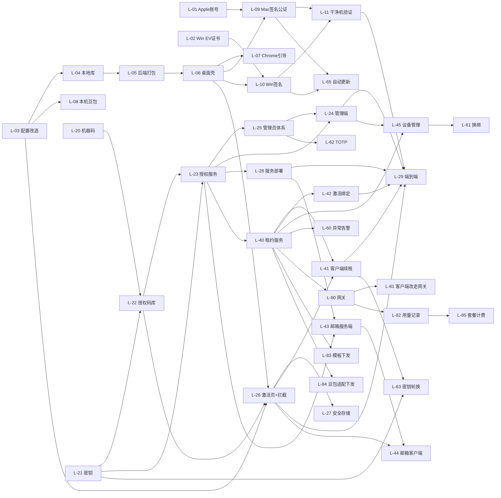

# 授权与桌面安装包：任务分解

对应设计：`docs/license-design.md`（v2）。本文件是本地任务清单，不在 taskhub 里建任务。

编号规则：`L-xx`，按阶段分段。「依赖」列是**必须先完成**的任务；「决策」列指需要你先拍板的事项（设计文档第 16 节的序号）。

## 1. 优先级怎么定的

| 级别 | 含义 | 判断标准 |
|---|---|---|
| **P0** | 不做完就不能对外收费发售 | 在「已签名安装包 + 授权强制生效 + 管理端能随时停用」这条主线上；或者**等待周期长、不能晚开始**（证书、主体、法务） |
| P1 | 发售后一个月内必须补上 | 影响运营效率和防倒卖强度，但没有它也能先小范围发售 |
| P2 | 之后再做 | 体验和效率优化 |

你的硬性要求是「管理端一定能控制他们能不能用」，所以**在线租约（L-40～L-42）是 P0**，只做离线授权码（阶段一）不够发售。

## 2. 总览

```
阶段 0  出包与证书      L-01 ~ L-11    能出一个已签名、系统不拦截的安装包
阶段 1  离线授权+管理端  L-20 ~ L-29    能手工发码、客户端激活、被拦截
阶段 2  在线租约+邮箱    L-40 ~ L-45    管理端真正能停用、单设备、邮箱注册
阶段 3  运营能力         L-60 ~ L-65    告警、换绑、TOTP、密钥轮换、自动更新
阶段 4  服务端能力+计费  L-80 ~ L-86    网关、模板下发、用量、计费（依赖决策 1、2）
合规与上线              L-90 ~ L-93    协议、审核、安全清理、压测
```

阶段 0 和阶段 1 **可以并行**：安装包工程师做阶段 0，后端工程师做阶段 1 的授权库和管理端，到 L-26 汇合。

## 3. 关键路径

整体最长的链（任何一环延迟，发售就延迟）：

```
L-01 主体/Apple账号 ─┐
L-02 Windows EV证书 ─┼─> L-09/L-10 签名流水线 ─> L-11 干净机验证 ─┐
L-03 配置改造 → L-04 本地库 → L-05 后端打包 → L-06 桌面壳 ──────┤
                                                              ├─> L-29 端到端 ─> 发售
L-21 密钥 → L-22 授权码库 → L-23 授权服务 → L-24 管理端 ──────┤
                                           └→ L-40 租约 → L-41 客户端续租 ┘
```

**必须马上启动的外部事务（不依赖任何开发）**：L-01、L-02、L-90。它们周期长且不由我们控制。

## 4. 依赖图



## 5. 任务清单

### 阶段 0：出包与证书

| ID | 任务 | 优先级 | 依赖 | 决策 | 粗估 |
|---|---|---|---|---|---|
| L-01 | 确定公司主体，申请 Apple Developer（含 D-U-N-S），拿到 Developer ID Application 证书 | **P0** | 无 | 6 | 外部 1～3 周 |
| L-02 | 申请 Windows EV 代码签名证书，选定云签名服务（CI 自动签名用） | **P0** | 无 | 6 | 外部 1～3 周 |
| L-03 | 配置改造：数据目录、`JWT_SECRET` 自动生成、去掉写死的路径和 Mongo 默认密码；后端只绑 127.0.0.1、随机端口、启动一次性令牌 | **P0** | 无 | | 2～3 天 |
| L-04 | 本地数据库：随包带 mongod 并由应用拉起/停止/崩溃恢复，数据放用户目录；同时把数据访问层收口；核对 mongod 随包分发的许可证条款 | **P0** | L-03 | 3 | 4～6 天 |
| L-05 | 后端用 Nuitka 打成独立可执行文件（mac arm64/x64、win x64），带 Playwright 驱动、提示词 JSON、静态资源 | **P0** | L-03、L-04 | | 4～6 天 |
| L-06 | Electron 外壳：窗口、拉起后端、健康检查、退出清理、前端本地加载、崩溃提示 | **P0** | L-05 | 4 | 3～5 天 |
| L-07 | 检测用户 Chrome，没装则引导安装；Playwright 走系统 Chrome；登录态目录放应用数据目录 | P1 | L-06 | | 1～2 天 |
| L-08 | 豆包账号简化为本机账号（去掉共享账号池假设、额度分配），登录态只存本机 | P1 | L-03 | | 2～3 天 |
| L-09 | macOS 打包流水线：嵌套二进制全签、Hardened Runtime、entitlements、公证、钉票据、arm64+x64 | **P0** | L-01、L-06 | 5 | 3～5 天 |
| L-10 | Windows 打包流水线：NSIS/安装器、全部 exe/dll 签名加时间戳、云签名接入 CI | **P0** | L-02、L-06 | 5 | 3～4 天 |
| L-11 | 干净虚拟机验证（全新 macOS、Windows 10、Windows 11）无拦截；杀软样本提交白名单 | **P0** | L-09、L-10 | | 2～3 天 |

验收要点：L-03 安装包里不含任何默认密钥；L-05 在没装 Python 的机器上能直接启动；L-09 `spctl --assess` 通过；L-10 `signtool verify` 通过；L-11 三台干净机一次安装、双击运行均无系统警告。

### 阶段 1：离线授权与管理端最小版

| ID | 任务 | 优先级 | 依赖 | 粗估 |
|---|---|---|---|---|
| L-20 | 机器码模块：三平台采集、HMAC 分量、Base32、校验位、命中 ≥2/3 的容差匹配；含单元测试和虚拟机/克隆场景测试 | **P0** | 无 | 3～4 天 |
| L-21 | 密钥体系：Ed25519 生成脚本、`kid` 机制、私钥保管方案（只在授权服务器）、公钥内置方式 | **P0** | 无 | 1～2 天 |
| L-22 | 授权码库：payload 格式、签发（服务端）与验证（客户端）共享模块，含篡改、换机、过期用例 | **P0** | L-20、L-21 | 3 天 |
| L-23 | 授权服务骨架：独立服务、独立库 `dongai_license`、licenses/devices/events 模型、签发/列表/停用 API | **P0** | L-21、L-22 | 4～5 天 |
| L-25 | 管理员体系：管理员账号、角色（超管/运营/只读）、审计日志（不可删改） | **P0** | L-23 | 2～3 天 |
| L-24 | 管理端最小前端：管理员登录、粘贴机器码签发（含校验位校验）、授权列表、停用/恢复/延期 | **P0** | L-23、L-25 | 4～5 天 |
| L-26 | 客户端：激活页（显示机器码、复制、粘贴授权码）、`license_client`、后端全局拦截（默认拒绝、出错也拒绝）、前端路由守卫 | **P0** | L-22、L-06、L-03 | 4～5 天 |
| L-27 | 授权码和租约存系统安全存储（macOS Keychain、Windows DPAPI） | P1 | L-26 | 2 天 |
| L-28 | 授权服务部署：服务器、HTTPS、域名、数据库备份、监控 | P1（发售前必须完成，所以实际排在 L-29 之前） | L-23 | 2～3 天 |
| L-29 | **阶段验收**：端到端——打包机拿到机器码、管理端发码、客户端激活可用、管理端停用后被拦截 | **P0** | L-24、L-26、L-11、L-41、L-42、L-28 | 2 天 |

注：L-28 虽然标 P1，但它是 L-29 的依赖，实际上必须在发售前完成。

### 阶段 2：在线租约与邮箱注册

| ID | 任务 | 优先级 | 依赖 | 决策 | 粗估 |
|---|---|---|---|---|---|
| L-40 | 租约服务端：签发、续租、吊销、单会话冲突处理、宽限期规则 | **P0** | L-23 | 7、8 | 4～5 天 |
| L-41 | 客户端续租线程：6 小时续租、72 小时宽限、时钟回拨检测、各错误码提示 | **P0** | L-40、L-26 | | 3～4 天 |
| L-42 | 首次激活绑定设备：一授权一台、冲突与换分量判定 | **P0** | L-40 | | 2 天 |
| L-43 | 邮箱注册登录服务端：验证码、限频、禁用一次性邮箱、找回密码；接入邮件发送服务 | P1 | L-23、L-28 | 10 | 3～4 天 |
| L-44 | 客户端邮箱注册登录页，账号与授权绑定；旧用户名账号兼容迁移 | P1 | L-43、L-26 | | 3 天 |
| L-45 | 管理端：设备列表、踢下线、申请单、延期 | P1 | L-40、L-24 | | 3 天 |

### 阶段 3：运营能力

| ID | 任务 | 优先级 | 依赖 | 粗估 |
|---|---|---|---|---|
| L-60 | 异常检测与告警：多设备、多 IP、跨地域、续租频率；自动冻结规则 | P1 | L-40 | 3～4 天 |
| L-61 | 换绑流程：申请、审核、年度次数限制、旧租约作废 | P1 | L-45 | 3 天 |
| L-62 | 管理员 TOTP 二次验证、IP 白名单 | P1 | L-25 | 2 天 |
| L-63 | 签名密钥轮换：客户端支持多公钥、新旧 `kid` 并存、强制升级流程 | P1 | L-21、L-41 | 2～3 天 |
| L-64 | 管理端看板：活跃授权、在线设备、将到期、告警数 | P2 | L-45 | 2 天 |
| L-65 | 自动更新通道：签名更新包、强制升级、版本清单 | P1 | L-09、L-10 | 3～4 天 |

### 阶段 4：服务端能力与计费（有决策依赖）

| ID | 任务 | 优先级 | 依赖 | 决策 | 粗估 |
|---|---|---|---|---|---|
| L-80 | 大模型和出图网关：校验租约和功能点、统一上游 Key、转发、限流 | **P0（若决策 1 选「做」）** | L-40 | 1 | 5～7 天 |
| L-81 | 客户端改走网关，移除用户自填 Key 的入口 | P0（同上） | L-80 | 1 | 3 天 |
| L-82 | 用量记录：按授权记录调用次数、token、出图数 | P1 | L-80 | 1 | 2～3 天 |
| L-83 | 提示词模板加密下发 + 本地加密缓存（绑定租约、到期即废） | P1 | L-40 | 2 | 4～5 天 |
| L-84 | 豆包页面适配配置（选择器、确认流程参数）服务端下发和热更新 | P1 | L-40 | | 3 天 |
| L-85 | 套餐、额度、计费与支付对接 | P1 | L-82 | | 另立项 |

决策 1 如果选「不做」，L-80、L-81、L-82 取消，防倒卖只剩设备绑定和租约，需要把这一点在发售前向你再确认一次。

### 合规与上线

| ID | 任务 | 优先级 | 依赖 | 粗估 |
|---|---|---|---|---|
| L-90 | 用户协议、隐私政策（写明收集设备指纹、豆包自动化的账号风险、生成内容归属），法务过一遍 | **P0** | 无 | 外部 1～2 周 |
| L-91 | 内容合规：生成内容审核、AI 生成标识 | P1 | L-80（走网关才好统一审核） | 3～5 天 |
| L-92 | 安全清理：仓库里的 `docker-compose.yml` 默认密码和暴露端口、`JWT_SECRET` 默认值，授权服务器端口收紧 | **P0** | 无 | 1 天 |
| L-93 | 压测与稳定性：并发续租、授权服务宕机时客户端宽限行为 | P1 | L-40、L-41 | 2～3 天 |

## 6. 建议的启动顺序

**第 1 天就能并行启动，互不依赖：**

| 谁 | 做什么 |
|---|---|
| 你 | L-01、L-02（申请证书）、L-90（协议），并回答第 16 节的决策 |
| 开发 A | L-03 → L-04 → L-05 → L-06 |
| 开发 B | L-20、L-21 → L-22 → L-23 |
| 任何人 | L-92（半天到一天，立刻可做） |

**第一个里程碑：** L-06 完成 + L-22 完成，此时有一个能启动的桌面壳和一个可验证的授权码库。
**第二个里程碑：** L-11 完成（已签名安装包无拦截）。
**第三个里程碑：** L-29 通过，这就是第一次对外发售的门槛。

## 7. 风险提示

- **证书时间不由我们控制**，L-01、L-02 一旦晚启动，整个发售日期都会被拖，所以排在最前面。
- **L-04 数据库方案**工作量和风险都大，建议先用 1 天做 spike：验证随包 mongod 在 macOS 和 Windows 上的启动、签名、杀软反应，再决定是否按 A 方案推进。
- **L-05 Nuitka 打包**第一次通常会遇到隐式导入和数据文件缺失，预留调试时间；Playwright 驱动和提示词 JSON 要显式带上。
- **L-10 Windows 云签名**在国内公司主体下能否受理，需要先问 CA，L-02 开始时就一起确认。
- 粗估是单人天数，只用来排序和看相对大小，不是承诺，开工前再逐个细化。
